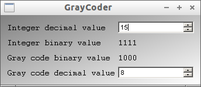

# GrayCoder

Convert integer to Gray code and vice versa.

GrayCoder is one of [Richèl Bilderbeek's tools](https://richelbilderbeek.github.io/tools/).

## Links

- [Source code](https://github.com/richelbilderbeek/GrayCoder)
- [Richèl Bilderbeek's tools](https://richelbilderbeek.github.io/tools/)
